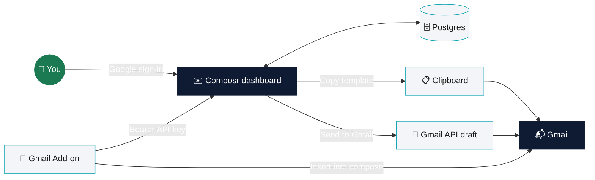
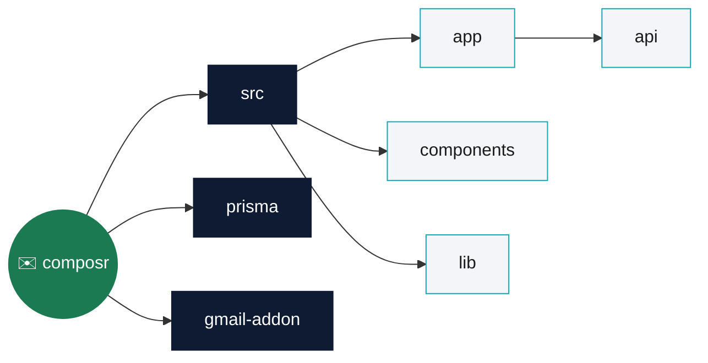
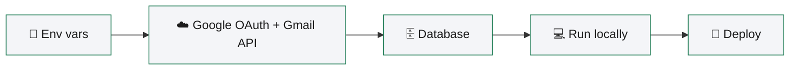
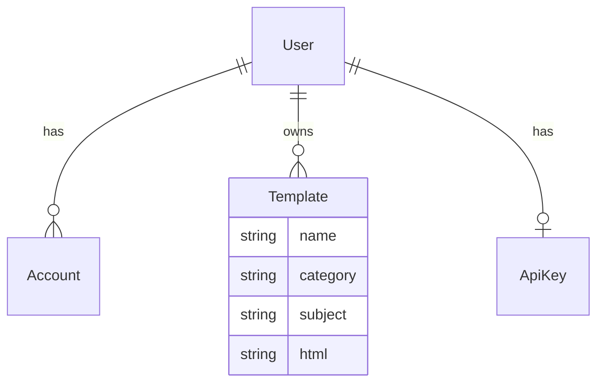
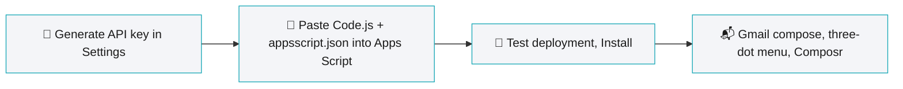

<div align="center">

# ✉️ Composr

**HTML email templates, one click away from Gmail.**
A dashboard for managing HTML email templates and getting them into Gmail: copied to the clipboard, pushed as a Gmail draft via the Gmail API, or inserted directly into an open compose window through a companion Gmail Add-on.


[Features](#-features) · [How it works](#-how-it-works) · [Tech stack](#-tech-stack) · [Structure](#-project-structure) · [Setup](#-setup) · [Deployment](#-deployment) · [Gmail Add-on](#-gmail-add-on) · [Scripts](#-scripts)

</div>

---

## ✨ Features

| | Feature | What it does |
|---|---|---|
| 📝 | **Template manager** | Create, edit and organise HTML email templates by category |
| 👀 | **Live preview** | See the rendered email alongside the raw HTML editor |
| 🔐 | **Google sign-in** | Templates are stored per user in Postgres |
| 📋 | **Copy template** | Copies the HTML straight to the clipboard for pasting into Gmail |
| 📨 | **Send to Gmail** | Creates a real Gmail draft via the Gmail API |
| 🧩 | **Gmail Add-on** ([`gmail-addon/`](./gmail-addon)) | Insert a template directly into an open compose draft from Gmail's own three-dot menu, without leaving Gmail |

Template categories in the app: `Follow-up` · `Cold Outreach` · `Newsletter` · `Announcement` · `Other`.

---

## 🔄 How it works

Three ways for a template to reach Gmail.



> [!NOTE]
> The web app uses your browser session. The Gmail Add-on calls the same `/api/templates` endpoints over HTTPS with a personal API key sent as `Authorization: Bearer <key>`, generated from the `/settings` page.

---

## 🧰 Tech stack

| Layer | Tool |
|---|---|
| Framework | [Next.js](https://nextjs.org) (App Router) + React + TypeScript |
| Styling | [Tailwind CSS](https://tailwindcss.com) |
| Auth | [Auth.js](https://authjs.dev) (NextAuth v5) with the Google provider |
| Database | [Prisma](https://www.prisma.io) + Postgres (developed against [Neon](https://neon.tech)) |
| Gmail | [googleapis](https://github.com/googleapis/google-api-nodejs-client) for Gmail draft creation |
| Hosting | [Netlify](https://www.netlify.com) via `@netlify/plugin-nextjs` |
| Add-on | [Google Apps Script](https://developers.google.com/apps-script) |

---

## 🗂 Project structure

Click a box to open that folder.



<details>
<summary><b>📄 Full tree</b></summary>

<br>

```
src/
  app/
    api/
      auth/[...nextauth]/     Auth.js route handler
      templates/               Template CRUD + send-to-gmail routes
      api-keys/                Personal API key for the Gmail Add-on
    templates/new, templates/edit   Template editor pages
    settings/                  API key management page
    page.tsx                   Dashboard (template list)
  components/                  UI components (editor, list, auth gate, etc.)
  lib/                         Prisma client, Auth.js config, Gmail helper, template-store API client
prisma/
  schema.prisma                 Database schema
  migrations/                   Prisma migration history
gmail-addon/                    Standalone Google Apps Script project (see its own README)
```

</details>

---

## 🚀 Setup

### Prerequisites

- Node.js 20+
- A Postgres database (e.g. a free [Neon](https://neon.tech) project)
- A Google Cloud project with the Gmail API enabled and an OAuth client



<details open>
<summary><b>1 · 🔑 Environment variables</b></summary>

<br>

Copy `.env.example` to `.env` and fill in your own values:

| Variable | Description |
|---|---|
| `DATABASE_URL` | Postgres connection string (e.g. from Neon), including `?sslmode=require` |
| `AUTH_SECRET` | Random secret used to sign session tokens, generate with `npx auth secret` |
| `AUTH_GOOGLE_ID` | OAuth client ID from Google Cloud Console |
| `AUTH_GOOGLE_SECRET` | OAuth client secret from Google Cloud Console |
| `AUTH_URL` | The app's public URL (e.g. `https://your-site.netlify.app`), required in production so Auth.js resolves the correct OAuth callback |

> [!IMPORTANT]
> None of these values are committed to the repo; `.env` is gitignored.

</details>

<details>
<summary><b>2 · ☁️ Setting up Google OAuth + Gmail API access</b></summary>

<br>

1. Go to [Google Cloud Console](https://console.cloud.google.com/) and create a project (or reuse one).
2. **APIs & Services → Library** → enable the **Gmail API**.
3. **APIs & Services → OAuth consent screen** (or the newer "Google Auth Platform" UI):
   - User type: **External**
   - Fill in app name and support email
   - **Scopes** → add `https://www.googleapis.com/auth/gmail.compose`
   - **Test users** → add the Google account(s) you'll sign in with, while the app is in "Testing" mode
4. **APIs & Services → Credentials → Create Credentials → OAuth client ID**:
   - Application type: **Web application**
   - Authorized redirect URIs:
     - `http://localhost:3000/api/auth/callback/google` (local dev)
     - `https://<your-deployed-domain>/api/auth/callback/google` (production)
5. Copy the generated **Client ID** and **Client secret** into your `.env`.

</details>

<details>
<summary><b>3 · 🗄 Database setup</b></summary>

<br>

1. Create a Postgres database (e.g. a Neon project) and copy its connection string into `DATABASE_URL`.
2. Apply the schema:

   ```bash
   npx prisma migrate dev
   ```

   This creates the `User`, `Account`, `Template`, and `ApiKey` tables.



</details>

<details>
<summary><b>4 · 💻 Running locally</b></summary>

<br>

```bash
npm install
npm run dev
```

Open [http://localhost:3000](http://localhost:3000).

> [!TIP]
> `npm install` runs `prisma generate` automatically via its `postinstall` script, so the Prisma client always matches the current schema.

</details>

---

## 🚢 Deployment

The app runs as a full Next.js server (SSR + API routes), not a static export. On Netlify this is handled by `@netlify/plugin-nextjs`, already configured in [`netlify.toml`](./netlify.toml) (`publish = ".next"`). To deploy:

1. Connect the repo to a Netlify site.
2. Set the environment variables from the table above in the site's **Environment variables** settings, using your production values (including `AUTH_URL` set to the site's own URL).
3. Add the production callback URL to the Google OAuth client's authorized redirect URIs.
4. Trigger a deploy.

---

## 🧩 Gmail Add-on

[`gmail-addon/`](./gmail-addon) is a self-contained Google Apps Script project, it is not built or deployed by Netlify. It talks to this app's `/api/templates` endpoints over HTTPS using a personal API key (generated from the `/settings` page) instead of a browser session.



See [`gmail-addon/README.md`](gmail-addon/README.md) for full setup instructions.

---

## 📜 Scripts

| Command | Description |
|---|---|
| `npm run dev` | Start the local dev server |
| `npm run build` | Production build |
| `npm run start` | Run the production build locally |
| `npm run lint` | Run ESLint |
| `npx prisma migrate dev` | Apply pending database migrations |
| `npx prisma studio` | Browse the database with Prisma's GUI |

<div align="center">

---

Made in Dhaka 🇧🇩 by **Moinul Islam Rehan**

</div>
